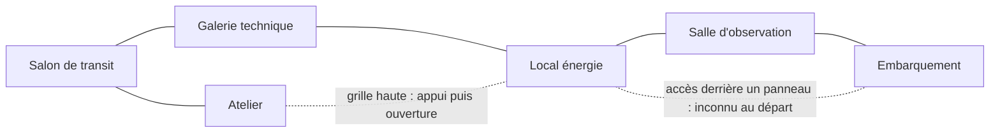

# AR-01 — Aventure de référence : évacuation de la station

> **Statut :** RÉFÉRENCE DE CONCEPTION ACCEPTÉE v1.0 — Q-50 / D-057, avec réglages initiaux Q-48/Q-49.
> **Date :** 2026-10-09.
> **Portée :** une aventure fixe de référence, pas la définition de tous les scénarios générés.
> **Implémentation, solveur, parcours joués et validation téléphone :** non réalisés.

Les sections de monde et de parcours sont des **attentes de conception à prouver**, pas des sorties de jeu. Le texte narratif de la section 15 reste un brouillon éditorial. [C-03](contrats/C-03-temps-reactions.md) et [C-04](contrats/C-04-risques-blessures.md) portent désormais les règles de temps et de risque extraites sans changement de cette référence.

## 1. Rôle et frontière d'accès

Cette aventure doit éprouver une partie complète de 15–30 minutes, plusieurs solutions concrètes et la fidélité entre action, état et récit. Elle n'est pas une succession imposée de clics.

**Document d'auteur contenant les solutions et secrets.** Il est accessible aux concepteurs, développeurs, reviewers techniques et outils de vérification ; il est interdit au playtester censé découvrir la partie. Celui-ci reçoit uniquement l'observation publique par la CLI ou la PWA, conformément à [C-01](contrats/C-01-actions-observation.md).

Une référence fixe et des tirages enregistrés permettent plus tard des tests reproductibles. Le choix de graine ou d'identifiant n'est pas une preuve de partie jouée.

## 2. Éléments acceptés

- Les décisions de la V2, dont actions composables sans parser, positions relatives simples, temps sur engagement, autosave, risque qualitatif et absence de duel, restent applicables.
- Personnage de référence : passager réveillé pendant le confinement (Q-24 / D-031).
- Menace de référence : une créature organique sensible au bruit, persistante et physiquement localisée (Q-25 / D-032).
- Objectif matériel : rétablir l'alimentation du départ, au-delà d'atteindre la capsule (Q-26 / D-033).
- Présence narrative : voix de l'assistance automatisée de la station, échanges scriptés sans LLM ni compagnon à déplacer (Q-27/Q-30, D-034/D-037).
- Carte à six pièces et deux détours (Q-28 / D-035), dont les placements et états de référence sont ensuite acceptés explicitement par Q-50 / D-057.
- Deux alimentations : circuit de station bruyant ou bloc transportable plus discret, contre davantage de manipulations (Q-29 / D-036).
- Dépressurisation reportée à une deuxième référence, toujours dans la cible du jeu (Q-31 / D-038).
- Un pas par action élémentaire, premier contact annoncé et une occasion de réagir (D-039/D-040).
- Santé : indemne → blessé → critique → défaite ; un soin améliore d'un état sans réinitialiser la menace (D-041).
- Une préparation supprimant le risque supprime le jet (D-042).
- Bloc de secours et créature trop volumineux pour les deux passages de maintenance (D-043/D-044).
- Commande de test sonore réutilisable de P vers O (D-045).
- Assistance fiable sur les procédures et systèmes, limitée sur la menace (D-046).
- Cloisons correctement fermées protectrices, sans destruction par la créature dans AR-01 (D-047).
- Traque réactive, pas de patrouille permanente (D-048).
- Une glissade préparée fait perdre les deux réactions suivantes à cette créature ; pas de chute identique gratuite après découverte du danger (D-049).
- Au moins un parcours sans blessure ni jet obligatoire doit être possible par préparation (D-050).
- Ressources d'AR-01 : une eau adaptée, un lubrifiant non inflammable, un soin ; pas de poids/slots (D-051).
- Franchissement exposé au résultat défavorable : passage accompli avec une aggravation, sans franchir une précondition impossible (D-052).
- Au plus une aggravation ordinaire par engagement ; départ en trois gestes avec conditions physiques vérifiées (D-053/D-054).

Les [interactions demandées](07-interactions-reference.md) restent dans la cible : AR-01 couvre huile, caisse, panneau secret et extinction. La dépressurisation préparée sera éprouvée séparément ; elle n'est pas nécessaire pour terminer AR-01.

## 3. Intention d'expérience

Un passager se réveille dans un petit secteur de transit. Le confinement est actif. Une capsule existe, mais le départ n'est plus alimenté. Des bruits inhabituels proviennent de la liaison vers l'embarquement. Une voix répond sur le réseau d'urgence.

L'aventure pose deux problèmes qui peuvent se préparer dans un ordre libre :

1. rendre l'évacuation matériellement possible ;
2. atteindre la capsule et partir malgré la menace et les obstacles.

Une solution environnementale n'est pas un bouton « victoire » : la neutralisation d'une menace ne remplace pas l'alimentation et l'embarquement. La voix explique les faits accessibles et le contexte, pas une solution omnisciente.

Titre public, nom de station, identité détaillée du passager et texte d'introduction final : travail éditorial restant, sans en faire de nouveaux mécanismes. Le scénario fixe sa situation jouable sans demander une quête supplémentaire pour expliquer tout l'incident.

## 4. Carte de base acceptée — six pièces

Les codes ci-dessous sont des repères d'auteur. Ils ne sont pas les identifiants publics remis au joueur.

| Repère | Lieu | Rôle | Éléments de référence |
| --- | --- | --- | --- |
| S | Salon de transit | Départ et compréhension de l'objectif | Poste d'appel, signalétique d'évacuation, cloison vers le secteur de service |
| A | Atelier de service | Préparation | Caisse stable, grille haute, eau d'extinction compatible, huile, soin |
| G | Galerie technique | Voie normale temporairement bloquée | Petit foyer d'incendie, cloisons de compartimentage |
| P | Local énergie | Remise en service du départ et exploration | Circuit dédié à la capsule, bloc d'énergie compatible transportable, panneau de commande |
| O | Salle d'observation | Zone exposée à la menace | Vitrage extérieur, passages isolables, espaces de dissimulation |
| E | Embarquement | Préparer et effectuer l'évacuation | Capsule, connexion d'énergie, accès à bord |

La voie normale S–G–P et l'accès A–P forment une boucle. P–O–E et le passage caché P–E fournissent deux approches de l'embarquement. Tous les traits du diagramme sont des possibilités physiques, pas des connexions nécessairement ouvertes et connues au départ.

Les conduits sont des connexions spéciales entre pièces, pas de nouvelles salles tactiques. L'intérieur de la capsule est une sous-position « à bord » de l'embarquement, séparée par son écoutille ; pas de septième pièce d'exploration.

La présence éventuelle d'un vitrage comme décor ne donne pas une action de brèche dans AR-01 : cette mécanique appartient à la deuxième référence (D-038). L'interface ne doit pas promettre un effet absent du périmètre.

## 5. État initial — synthèse

Les sections 11 à 14 et C-03/C-04 portent les définitions précises acceptées. Cette synthèse ne remplace pas les preuves futures d'accessibilité.

- Le passager commence indemne dans S, avec son interface privée de transit, sans outil initial non déclaré.
- Le lien S–A est utilisable ; l'atelier est accessible avant les obstacles qui demandent ses objets.
- Le feu est initialement confiné en G par des séparations fermées. Il n'agit pas comme une échéance globale cachée pendant que le joueur découvre les menus.
- La grille A–P est visible, haute et fermée. Son caractère atteignable, son ouverture et sa traversée sont distincts.
- L'accès P–E existe déjà dans les données fixes mais demeure inconnu tant que le panneau ne le révèle pas. Le menu ne porte pas le nom « passage secret ».
- La capsule est intacte, départ non alimenté ; aucun badge secret supplémentaire n'est ajouté au puzzle.
- La créature commence sur le trajet en O, en attente ; ses réactions suivent C-03. Aucune téléportation n'est autorisée.

Les barrières de départ doivent rendre possible un apprentissage sans danger immédiat, tout en gardant une causalité physique : pas de « safe room » magique annulant tous les dangers futurs.

## 6. Deux approches d'alimentation

### EN-01 — Rétablir le circuit du départ

Dans P, rétablir une alimentation dédiée à l'évacuation par une commande compréhensible et signalée. Le branchement et ses effets doivent être physiques dans les données, pas un drapeau nommé « gagne ».

La remise en service produit un son fort du relais situé en P pendant la réaction de cet engagement. Il suit les canaux acoustiques réellement ouverts. Les isoler est une préparation valide, pas une annulation fictive du coût sonore. Le circuit alimente ensuite le départ sans ressource transportée.

### EN-02 — Apporter le bloc de secours à la capsule

Dans P, prendre un bloc compatible puis l'installer en E. La capsule reçoit une alimentation locale sans remettre le circuit de station en service. Le bloc ne traverse ni A–P ni P–E, trop étroits (D-043).

Contreparties acceptées : transport, manipulation et voie normale obligatoires tant que le bloc est porté. Le joueur peut le déposer pour changer d'approche. Ne pas ajouter un poids chiffré, un nombre de mains ou une pénalité de mobilité sans arbitrage.

Ces deux solutions doivent fonctionner séparément, être annoncées par des indices cohérents et ne pas exiger le même objet unique en amont. Un simple bouton supplémentaire sans coût ou conséquence distincte ne justifie pas une deuxième solution.

## 7. Approches des obstacles

### OB-01 — Accéder à l'énergie

- **Voie normale :** maîtriser le feu avec le moyen approprié, puis franchir G vers P.
- **Voie de maintenance :** déplacer la caisse sous la grille, l'atteindre, l'ouvrir et traverser A–P. Le feu peut rester confiné plutôt qu'être obligatoirement éteint.

Le moyen d'extinction et l'appui se trouvent avant l'obstacle. L'utilisation du conduit ne doit pas laisser le joueur sans possibilité de retour faute d'appui de l'autre côté : la géométrie de P doit être explicitement décrite.

### OB-02 — Atteindre l'embarquement

- **Contourner :** découvrir et ouvrir le passage P–E, puis l'emprunter si ses conditions restent satisfaites.
- **Détourner/ralentir :** exploiter un bruit, des positions et éventuellement un sol glissant pour traverser P–O–E.

La créature ne franchit pas A–P ni P–E (D-044). Les conduits ne l'empêchent pas d'utiliser une voie normale ; ils ne la déplacent pas automatiquement vers la nouvelle pièce du joueur.

Le test de l'avertisseur depuis P fait sonner un équipement situé en O (D-045). Le bruit est une donnée perceptible par la créature, pas un ordre qui garantit sa coopération ni une indication donnée au joueur sur sa position cachée.

La préparation d'une exposition au vide ne fait pas partie d'AR-01 (D-038). Pour la deuxième référence, protection disponible avant la brèche, isolement des passages, outils, vulnérabilité de la créature et retour vers la capsule devront tous être spécifiés.

## 8. Voix distante — cadre fonctionnel

- Identité acceptée : assistance automatisée de la station (D-037), dialogues bornés, pas un appel à un modèle génératif.
- Fiabilité acceptée : procédures et état des systèmes exacts, connaissance limitée de la menace (D-046). La voix n'invente pas un point de position dans la carte du joueur.
- Messages bornés et choisis, sans LLM ni accès omniscient aux secrets.
- Pas de sauvegarde d'un compagnon physique ni de seconde menace ajoutée au prétexte du récit.
- Informations critiques également accessibles par les lieux ou interfaces : sauter un dialogue ne doit pas supprimer une clé de compréhension obligatoire.
- Lecture et échanges d'information gratuits sur l'interface privée de transit. Le test d'avertisseur produit un son public par une action distincte et engageante ; lire l'assistance ne le déclenche pas.
- Au plus quelques moments narratifs significatifs ; pas d'arbre de dialogue de campagne importé dans une partie courte.

## 9. Choix du deuxième entretien de référence

| Question | Réponse | Décision |
| --- | --- | --- |
| Q-28 Carte | Conserver la carte à six pièces comme base | D-035 |
| Q-29 Alimentation | Deux solutions, avec bruit contre manipulations supplémentaires | D-036 |
| Q-30 Voix | Assistance automatisée de la station | D-037 |
| Q-31 Vide | Réserver le cas à une deuxième référence | D-038 |

### Règles générales acceptées ensuite

| Questions | Résultat | Décisions |
| --- | --- | --- |
| Q-32 à Q-35 | Un pas par action élémentaire ; avertissement de contact ; trois états de blessure ; préparation pouvant supprimer le jet | D-039 à D-042 |
| Q-36 à Q-39 | Bloc trop large, conduits infranchissables par la créature, avertisseur réutilisable, assistance fiable mais limitée | D-043 à D-046 |
| Q-40 à Q-43 | Cloisons protectrices, traque réactive, deux réactions perdues sur huile et parcours sûr possible | D-047 à D-050 |
| Q-44 à Q-47 | Consommables bornés, fuite en succès partiel, plafond d'une aggravation, départ physique en trois gestes | D-051 à D-054 |
| Q-48 à Q-50 | D6 de référence, ordre et propagation, acceptation d'AR-01 v1.0 comme conception | D-055 à D-057 |

Le paquet détaillé est accepté en conception (D-057), pas en exécution. La durée cible n'est pas mesurée et les parcours ne sont pas encore joués.

## 10. Preuves à produire, pas encore acquises

- Au moins un parcours de départ à évacuation pour chaque approche conservée ; coût, risque et effet réellement différents.
- Cas négatifs : ressource absente, passage fermé, bloc perdu, appui déplacé, menace ailleurs, combinaison non adaptée.
- Reprise au milieu d'un changement du monde sans duplication, nouveau jet ou perte de connaissance.
- Menus sans fuite des secrets ; même observation pour UI, CLI et playtester.
- Pas d'obligation de jouer toutes les scènes pour progresser ; durée 15–30 minutes à mesurer humainement, pas déduite du seul nombre de tours.

Le [journal des parties humaines](journal-parties-humaines.md) reste vide. Une revue documentaire de ces solutions ne remplace ni exécution du moteur ni partie sur téléphone.

## 11. Données fixes de référence

Cette section est la source de vérité des placements, positions et capacités particulières d'AR-01, acceptée par D-057. Leur future validation exécutable devra partir de ces données, sans injections cachées pour faire passer les parcours.

### 11.1 Passages

| Passage | État de départ | Conditions et effet de l'ouverture |
| --- | --- | --- |
| S–A | Ouvert et connu | Passage normal, sans obstacle |
| S–G | Cloison fermée, connue | Manipulable des deux côtés ; le foyer en G est à portée depuis le seuil côté S une fois ouvert |
| G–P | Cloison fermée, connue | Manipulable des deux côtés ; ne demande ni clé ni alimentation |
| A–P | Grille fermée, visible côté A | Appui stable sous la grille pour ouvrir/traverser depuis A ; appuis intégrés côté P pour le retour ; trop étroit pour le bloc/la créature |
| P–O | Cloison fermée, connue | Manipulable des deux côtés ; mécanisme grippé dont l'ouverture émet un bruit normal dans la pièce de l'acteur, indépendamment de la position de la créature |
| O–E | Ouvert | Cloison refermable des deux côtés ; pas de courant requis pour l'isoler |
| P–E | Panneau fermé, passage inconnu | Ouvrir le panneau découvre et ouvre cet accès ; trop étroit pour bloc/créature ; retour possible, sans oublier sa découverte si refermé |
| E–capsule | Écoutille ouverte, intérieur vide | Connexion à une sous-position « à bord », pas une septième salle exploratoire ; fermeture manuelle depuis l'intérieur |

L'ouverture d'un passage n'ouvre pas les autres. Une cloison a le même état dans les deux sens. Les portes manuelles restent manipulables quel que soit le choix d'énergie.

Pour cette fixture, les cloisons et le panneau fermés bloquent les passages, les sons et la propagation du feu. Une grille fermée laisse passer les sons mais bloque la traversée du personnage ; son canal de feu suit l'ouverture dans cette abstraction. Les capacités sont portées par les liaisons, distinctes pour son, gabarit et feu. Les règles d'étanchéité au vide restent hors AR-01.

Le nom de destination d'un accès inconnu n'est pas affiché avant découverte. Une fois la destination et le passage connus, leur gabarit est annoncé avant transport. Aucun refus dû au bloc trop large ne détruit ni dépose silencieusement l'objet.

### 11.2 Objets et dispositifs

| Lieu | Élément | Portée de référence |
| --- | --- | --- |
| A | Une caisse de service | Appui stable déplaçable au sol de l'atelier ; n'entre pas dans l'inventaire de poche |
| A | Un récipient d'eau adapté au foyer | Une dose ; porter, verser sur un foyer à portée ; contenant vide persistant après usage |
| A | Un récipient d'huile de maintenance | Une dose ; rendre un seuil glissant ; contenant vide persistant. Dans AR-01, huile explicitement non inflammable dans les règles de fiction |
| A | Un soin d'urgence | Un usage améliore d'un état, consommé ; pas de bonus permanent ni de retour à un état passé |
| P | Console de départ | Réactive le circuit indépendant de la capsule en un engagement ; provoque un bruit net du relais situé en P |
| P | Bloc de secours chargé | Disponible sans préalable de réparation du circuit ; transportable, trop large pour les conduits ; installable en E |
| P | Panneau de commande secondaire | Ouvrable à la main ; accès P–E et bref élément de récit découverts derrière, pas un puzzle de code supplémentaire |
| P | Test d'avertisseur | Contrôle réutilisable commandant l'émetteur fort dans une alcôve de O ; durée et réaction selon C-03 |
| E | Capsule autonome de survie | Énergie de départ absente ; connexion pour bloc, intérieur accessible et écoutille manuelle |

Tous les éléments listés sont perceptibles à l'arrivée dans leur pièce, sauf le contenu derrière le panneau et la destination du conduit avant sa découverte. Le panneau lui-même, la console et le bloc sont visibles dès l'arrivée en P ; ils ne sont pas cachés derrière une commande de recherche secrète.

Pour la référence, les petits objets portables peuvent être transportés ensemble. Aucun puzzle de nombre de cases de poche, poids détaillé ou nombre de mains n'est ajouté. La contrainte de gabarit du bloc reste réelle. Cette simplification d'AR-01 ne remplace pas les tests d'intégrité d'un transfert refusé prévus par C-05.

Pas d'outil spécialisé nécessaire pour les loquets, panneau et branchement : poignées, connecteur compatible et signalétique sont compréhensibles par le passager. Les outils de brèche appartiendront à la deuxième référence.

### 11.3 Salle d'observation et positions relatives

O comporte le seuil technique vers P, le trajet vers E, et une alcôve d'équipement contenant l'avertisseur. Une paroi opaque coupe la vue entre cette alcôve et le trajet P–O–E.

La créature est initialement sur la zone de passage en O. Rechercher un son dans l'alcôve lui fait **réellement changer de position** : ce n'est pas un malus de vigilance appliqué à distance. Les déplacements P→O et O→E du trajet balisé n'entrent pas dans l'alcôve.

Le sol huilé du passage P–O se prépare **au pied de la cloison côté P**, accessible même fermée. Un bord sec balisé permet un franchissement prudent. En se précipitant depuis O, la créature franchit la séparation puis glisse dans P, à cette même position ; sa réaction s'arrête là. Elle reste présente au seuil de P, temporairement incapable d'intercepter, pas téléportée ni effacée.

Les déplacements d'un personnage se font entre les positions pertinentes pour l'action, pas case par case. Être dans la même pièce n'implique pas automatiquement être visible : paroi opaque et positions locales comptent. Le modèle de référence n'accorde pas de vision à travers une porte entre deux pièces ; le passage ou un événement perceptible révèle ce qui est effectivement présent.

### 11.4 Connaissances et assistance au départ

Le passager connaît les noms indiqués par la signalétique, pas la topologie cachée. Une interface personnelle de transit restitue les messages privés de l'assistance : lecture et choix d'information ne font pas de bruit dans la station.

Le contrôleur sonore est une autre action, explicitement engageante. L'assistance sait lire les circuits et procédures, pas la position de la créature ni l'accès caché P–E.

## 12. Règles contractuelles à appliquer

Les règles initialement proposées dans cette section ont été acceptées par D-055 à D-057 et extraites vers leurs contrats, pour ne pas maintenir deux copies concurrentes.

| Sujet | Source normative |
| --- | --- |
| Unité d'action, ordre action/dangers/réaction/conclusion | [C-03 — Temps et réactions](contrats/C-03-temps-reactions.md) |
| Perception, priorité des sons, premier contact, gabarit et poursuite | [C-03 — Temps et réactions](contrats/C-03-temps-reactions.md) |
| Durée de l'avertisseur, réactions perdues, mémoire de l'huile, propagation du feu | [C-03 — Temps et réactions](contrats/C-03-temps-reactions.md) |
| Blessures, soin, plafond d'incidents, D6 et interception unique | [C-04 — Risques et blessures](contrats/C-04-risques-blessures.md) |
| Refus, menus, consultation et informations publiques | [C-01 — Actions et observation](contrats/C-01-actions-observation.md) |
| Identité, effets persistants et cohérence de sauvegarde | [C-05 — Monde et conséquences](contrats/C-05-monde-consequences.md) |

AR-01 définit les valeurs de contenu qui alimentent ces règles : relais fort en P à la remise en service, mécanisme normal bruyant P–O, autres gestes discrets, alcôve opaque, sol glissant côté P, foyer en G. Le test sonore attire par perception ; il ne donne jamais un déplacement forcé ou une invulnérabilité.

## 13. Parcours témoins acceptés en conception — à prouver par exécution

Chaque numéro représente un engagement. Observer un élément, lire les indications ou ouvrir un menu peut s'intercaler librement, sans numéro ni pas de temps. Les parcours ne sont ni des commandes déjà implémentées ni des solutions communiquées au playtester.

### P-A — Maintenance, circuit, accès découvert

| Pas | Action depuis l'état résultant du pas précédent | Résultat attendu |
| --- | --- | --- |
| 1 | S → A | Atelier accessible |
| 2 | Déplacer la caisse sous la grille | Grille atteignable, pas encore ouverte |
| 3 | Ouvrir la grille | Accès A–P ouvert |
| 4 | Traverser A → P | Local énergie atteint ; feu G toujours confiné |
| 5 | Ouvrir le panneau secondaire | Passage P–E découvert et ouvert |
| 6 | Traverser P → E par l'accès étroit | Pas de bloc porté ; créature immobile en O, pas de contact à travers une autre pièce |
| 7 | Fermer la cloison E–O | Embarquement isolé ; P–O reste également fermé |
| 8 | Revenir E → P par le passage découvert | Retour praticable, sans appui supplémentaire |
| 9 | Réactiver le circuit de départ | Capsule alimentée ; bruit en P, mais aucune liaison acoustique ouverte vers O |
| 10 | Traverser P → E par l'accès étroit | Le bloc n'a pas été transporté, le circuit reste actif |
| 11 | Entrer dans la capsule | Position réellement à bord |
| 12 | Fermer l'écoutille | Capsule isolée |
| 13 | Commander le départ | Évacuation si toutes les conditions de la section 14 tiennent |

Pourquoi sans dé obligatoire : les manipulations préparées n'ont pas de risque résiduel et le bruit est isolé. O–E doit être refermé **avant** la remise en service, car le passage secret ouvert relie encore P à E et transmettrait sinon le son vers O. Une prévisualisation tenant compte des connaissances peut nommer le bruit et les ouvertures connues, pas certifier une position cachée de la menace.

Ce témoin court n'est **pas** la durée d'une première découverte : la cible 15–30 minutes devra être mesurée sur téléphone, avec lecture et exploration. Ne pas allonger artificiellement les animations pour atteindre un chiffre.

### P-B — Voie normale, bloc et avertisseur

| Pas | Action | Résultat attendu |
| --- | --- | --- |
| 1 | S → A | Accès aux ressources |
| 2 | Prendre le récipient d'eau | Une dose portée |
| 3 | A → S | Retour au seuil de G |
| 4 | Ouvrir S–G | Foyer visible et à portée ; première exposition de la connexion |
| 5 | Arroser le foyer depuis le seuil S | Dose consommée, G éteint avant propagation |
| 6 | S → G | Passage désormais sûr |
| 7 | Ouvrir G–P | Accès normal au local énergie |
| 8 | G → P | Local énergie atteint, P–O fermée |
| 9 | Prendre le bloc de secours | Bloc porté, pas de circuit de station réactivé |
| 10 | Déclencher le test d'avertisseur | Créature en O rejoint l'alcôve ; test actif pour deux réactions suivantes |
| 11 | Ouvrir P–O | Première réaction occupée par le test ; absence de ligne de vue depuis l'alcôve |
| 12 | P → O par le trajet balisé | Deuxième réaction occupée, test finit après cette réaction |
| 13 | O → E par la traversée hors de l'alcôve | Créature n'a pas reçu la position du joueur par magie |
| 14 | Fermer E–O | Liaison normale protectrice fermée |
| 15 | Installer le bloc dans la capsule | Objet transféré, alimentation locale active |
| 16 | Entrer dans la capsule | À bord |
| 17 | Fermer l'écoutille | Capsule isolée |
| 18 | Commander le départ | Évacuation |

Le circuit de station n'a pas été réactivé et le bloc n'a traversé aucun accès étroit. La diversion ne reste sûre que sous ses conditions de visibilité et perception ; activer un avertisseur face à un poursuivant qui voit déjà le joueur n'est pas une garantie de salut.

### P-C — Bloc et seuil huilé

Le préfixe compte cinq engagements, sans montée ou déplacement implicite supplémentaire : la mise à portée sur un appui stable fait partie de la manipulation de la grille, conformément aux trois gestes annoncés en Q-32 (déplacer, ouvrir, traverser).

| Pas | Action | Résultat attendu |
| --- | --- | --- |
| 1 | S → A | Atelier accessible |
| 2 | Prendre le récipient d'huile | Une dose portée |
| 3 | Déplacer la caisse sous la grille | Appui stable en place |
| 4 | Ouvrir la grille depuis l'appui | Accès A–P ouvert |
| 5 | Traverser A → P | Local énergie atteint sans traverser le foyer |
| 6 | Verser l'huile au pied de P–O, côté P | Dose consommée, zone réelle et accessible devenue glissante |
| 7 | Prendre le bloc | Bloc prêt avant l'ouverture ; pas d'essai de conduit avec lui |
| 8 | Ouvrir P–O | Bruit en P ; créature O→P, glissade au seuil dans P ; réaction arrêtée, compteur de deux réactions futures |
| 9 | P → O prudemment, par le bord sec | Première réaction suspendue ; créature toujours dans P |
| 10 | O → E | Deuxième réaction suspendue ; compteur à zéro pour la prochaine réaction |
| 11 | Fermer E–O | La créature récupère dans P ; elle ne rejoint pas E en un pas et la dernière cloison est maintenant fermée |
| 12 | Installer le bloc | Alimentation locale |
| 13 | Entrer dans la capsule | À bord |
| 14 | Fermer l'écoutille | Capsule isolée |
| 15 | Commander le départ | Évacuation |

Cette version de P-C dépend du placement précis et de la réaction précipitée à l'ouverture. Si le moteur final résout autrement la perception, ce témoin doit être revu, pas maintenu « validé » par modification manuelle de l'état du PNJ.

### P-D — Imprévu et récupération, à tester ultérieurement

- Bloc déposé car le joueur découvre la largeur du raccourci : l'objet reste au sol ; revenir au circuit demeure possible.
- Eau gaspillée : la voie de maintenance reste possible tant que ses conditions physiques sont conservées ; pas d'apparition d'un second récipient par secours narratif.
- Menace déplacée avant P-B : observer ses signes et réévaluer le plan ; ne pas forcer l'agent à exécuter le témoin comme si elle était restée en O.
- Fenêtre de diversion manquée : refuser la fausse sécurité, présenter le risque ou reculer/fermer/repréparer selon l'état réel.
- État critique : conserver la capacité de se déplacer ; un soin peut améliorer l'état sans rendre une zone exposée sûre.

## 14. Conditions de conclusion acceptées en conception

### 14.1 Évacuation

La seule victoire principale d'AR-01 est un départ effectivement engagé avec le personnage vivant à bord, la capsule alimentée par l'une des deux sources et son écoutille fermée. Une simple présence en E ou un état de créature ne suffit pas.

La cabine doit être isolée d'une menace active : une créature déjà présente à bord n'est pas évacuée sans effet avec le joueur au seul motif que la porte est fermée. Dans la fixture, l'approche d'une cabine ouverte reste une situation de contact ordinaire ; embarquer n'est pas une immunité instantanée. Les parcours préparés laissent la créature hors de la zone d'embarquement avant ces gestes.

Le départ coûte un engagement. Les contrôles de fin lisent le résultat complet de cet engagement ; aucun personnage en défaite ne peut être déclaré évacué après coup. L'intérieur fermé de la capsule est une séparation physique, pas une invulnérabilité due à l'écran de fin.

Le dénouement reflète des faits : source d'énergie utilisée, blessure finale, accès réellement emprunté, contenu découvert. Pas de bonus invisible ni de victoire « meilleure » attribuée à une solution arbitrairement privilégiée.

### 14.2 Défaite

Atteindre la défaite dans la chaîne de blessures conclut la partie. Pas de retour à un tour antérieur ; une reprise après fermeture réouvre ce résultat, pas un nouveau jet.

La référence ne rend pas manipulable une destruction irréversible des deux sources d'énergie. Elle doit rester récupérable au niveau matériel après un simple dépôt d'objet ou une fermeture de cloison. Ce n'est pas une garantie pour tout comportement ni tous les futurs contenus : C-08 devra définir les scénarios d'objectif réellement détruit avant de les exposer.

### 14.3 Pas de conclusion automatique pour stagnation

Le détecteur de stagnation des bots peut arrêter et diagnostiquer un test ; il ne prononce pas la défaite du joueur. Pas de minuterie globale masquée si le joueur lit, attend derrière une cloison ou change d'idée.

## 15. Proposition de rythme narratif

Les textes suivants sont des **exemples d'auteur**, pas encore une version finale ni des indices de solution obligatoires.

### 15.1 Ouverture de travail

« Le siège se redresse sans prévenir. Au plafond, les flèches d'embarquement sont rouges. Votre terminal de transit affiche : CONFINEMENT EN COURS. Puis une voix calme, dans l'écouteur du siège : “Une capsule de secours est disponible. Son circuit de départ ne répond pas.” Le diagnostic se termine par le carillon habituel d'une annonce d'embarquement. Personne ne se lève. »

Le joueur doit comprendre immédiatement où il est, ce qu'il vise et qu'il a le temps de lire. Pas de récit long avant sa première décision.

### 15.2 Trois prises de parole utiles

1. **Au réveil :** état du confinement et objectif connu d'évacuation.
2. **En consultant l'énergie :** circuit principal indisponible, source locale compatible possible. Informations de procédure, pas ordre d'itinéraire.
3. **Au départ :** confirmation factuelle d'alimentation, fermeture et lancement ; quelques mots adaptés au résultat.

Le joueur peut consulter de nouveau les informations déjà reçues. Sauter une réplique ne rend pas un prérequis incompréhensible : indications correspondantes sur équipements et carte connue.

### 15.3 Indices publics de préparation

| Situation | Indice proposé, consultable sans engagement | Ce qui n'est pas révélé |
| --- | --- | --- |
| Grille haute | Poignée hors de portée, caisse stable sous la hauteur d'accès, ancrages intégrés visibles dans le conduit une fois ouvert | Pas de bouton « solution de maintenance » avant préparation |
| Foyer | Signalisation du compartiment et récipient d'extinction adapté ; risque d'extension par une cloison laissée ouverte | Pas d'inventaire de toutes les pièces cachées |
| Énergie | Console « circuit de départ » désarmée, relais visiblement bruyant, connecteur du bloc compatible avec le départ | Pas de certitude sur l'endroit où la créature entendra |
| Panneau | Poignée de service et marques d'ouverture ; même action plausible qu'un panneau sans passage | Destination P–E avant ouverture |
| Avertisseur | Plan de l'émetteur et cycle de trois réactions indiqué ; paroi opaque observable quand O est visible | Pas de message « créature distraite » si elle n'a pas été observée |
| Huile | Mention de lubrifiant glissant non inflammable pour cet équipement ; seuil et bord sec identifiables | Pas de prévision de l'emplacement caché de l'ennemi |

Ce sont des faits sur des objets et leurs usages, pas une liste exhaustive des gestes optimaux. Les noms et propriétés se lisent gratuitement ; leur modification engage une action.

### 15.4 Découverte optionnelle

Derrière le panneau secondaire, un relevé de service indique que le réseau d'urgence avait demandé le maintien d'un accès d'évacuation alors que le confinement général le masquait. L'assistance peut confirmer l'état du réseau, pas expliquer l'origine de la créature. Cette trace donne du sens au passage sans créer un second objectif d'enquête.

Nom de la station et titre public restent des éléments éditoriaux non bloquants. Ne pas créer de compte de personnage, de journal métaprogressif ou de quête de collection pour cette trace.

## 16. État des preuves et suite

| Niveau | État au 09/10/2026 | Portée |
| --- | --- | --- |
| Choix de gameplay et placements | Acceptés par le porteur du projet, Q-24 à Q-50 | Référence de conception D-057 ; attentes à implémenter |
| Revue documentaire des parcours | Réalisée sur papier, corrections ci-dessous | Ne prouve ni exécution ni absence de tout contre-exemple |
| Contrats de temps/risque | C-03/C-04 extraits des choix acceptés | Portée AR-01, pas simulation universelle |
| Commandes et parcours automatisés | Non implémentés, non exécutés | Restent à prouver depuis un état initial complet |
| Solveur | Non implémenté, non exécuté | Aucun taux ou résultat de résolubilité revendiqué |
| Partie sur téléphone | Non effectuée | Journal humain vide ; aucun statut de parcours humain validé |
| Durée, plaisir, découvrabilité | Non mesurés | Cible 15–30 minutes, pas un résultat déduit des 13/18/15 engagements |
| Texte final et identité visuelle | Non validés | Exemples de la section 15 conservés comme brouillon éditorial |

Avant développement global : compléter les contrats d'entités, d'observation détaillée, de sauvegarde/replay, de génération et de preuves ainsi que la deuxième référence du vide. L'acceptation d'AR-01 n'autorise pas les agents à inventer ces éléments.

Pour l'implémentation future : si un parcours contredit un contrat ou ne passe pas, documenter le contre-exemple et revenir en arbitrage. Ne pas modifier silencieusement un état de PNJ, un délai ou une attente de test pour rétablir le vert.

### 16.1 Contradictions corrigées pendant la revue documentaire

- Le premier P-A relançait le relais avant d'isoler le détour acoustique P–E–O. La version courante ferme O–E puis revient rétablir le courant ; le coût est visible dans ses treize engagements.
- La première description de P-C posait l'huile côté P mais faisait tomber l'entité côté O. La flaque et la glissade sont maintenant toutes deux côté P ; la créature est réellement déplacée et conservée à ce seuil.
- L'attrait de la porte pouvait concurrencer le test d'avertisseur sans priorité définie. Les sons perçus sont maintenant ordonnés par intensité puis récence ; le test fort ne remplace jamais une perception visuelle directe.
- Une formule de préfixe donnait six pas alors que cinq gestes étaient listés. P-C est désormais numéroté de bout en bout, quinze engagements.
- Le texte de réveil suggérait une présence juste derrière une cloison alors que la créature est isolée ailleurs. Le carillon privé de l'assistance remplace ce faux indice sonore.

Ces corrections ont porté sur les propositions d'auteur avant acceptation D-057, pas sur un moteur exécuté. Le D6 a ensuite été choisi par Q-48 / D-055 ; son calibrage reste à éprouver. Les questions d'intérêt et de découvrabilité ne sont pas résolues par cette seule revue.
