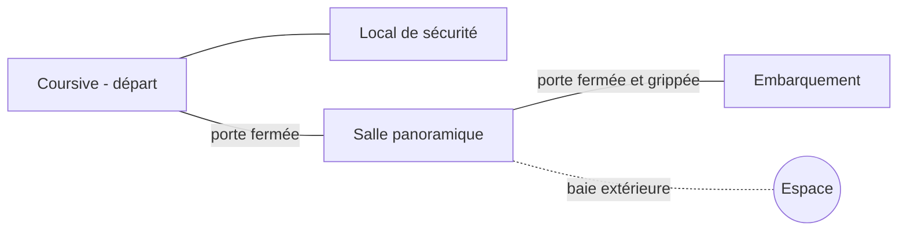

# AR-02 — Aventure de référence : dépressurisation préparée

> **Statut :** RÉFÉRENCE DE CONCEPTION ACCEPTÉE v1.0 — Q-51 à Q-67 (D-058 à D-074).
> **Date :** 2026-10-10.
> **Portée :** deuxième référence de la famille d'évacuation, consacrée à la dépressurisation préparée R-01 (D-038). Ni deuxième famille narrative, ni variante de la carte d'AR-01.
> **Implémentation, solveur, parcours joués et validation téléphone :** non réalisés.

## 1. Rôle et frontière d'accès

AR-02 doit prouver qu'une baie extérieure percée produit un vide réel, que la protection préparée compte, que le vide suit les passages ouverts et qu'il agit sur la créature — sans jamais remplacer l'évacuation. Elle est volontairement plus courte qu'[AR-01](08-aventure-reference.md) et isole ces règles : ni feu, ni huile, ni bloc (D-058).

**Document d'auteur contenant les solutions.** Mêmes règles d'accès qu'AR-01 : interdit au playtester aveugle, qui ne reçoit que l'observation publique ([C-01](contrats/C-01-actions-observation.md)).

## 2. Éléments acceptés

| Sujet | Choix accepté | Décision |
| --- | --- | --- |
| Forme | Courte aventure complète, environ quatre pièces, même passager, même type de créature sensible au bruit ; seules les règles du vide sont nouvelles | D-058 |
| Sans protection | Défaite immédiate, hors plafond D-053 ; toute action connue pour y exposer est annoncée mortelle avant engagement ; seul le joueur ouvre une brèche | D-059 |
| Protection | Combinaison étanche : une action pour l'enfiler, protection complète (exposition et aspiration), sans jauge d'air ; une cloison étanche fermée sépare deux pressions ; une caisse ne protège pas | D-060 |
| Propagation | Immédiate dans tout ce qui est relié à la brèche par un passage ouvert ou non étanche ; ouvrir plus tard étend le vide ; se préparer = fermer avant | D-061 |
| Créature exposée | Expulsée de la station dans la pièce percée, inerte ailleurs ; plus aucune réaction ; pas une victoire | D-062 |
| Plan | Coursive, local de sécurité, salle panoramique, embarquement ; capsule déjà alimentée ; créature à l'embarquement ; porte grippée et bruyante ; alerte de l'assistance au réveil | D-063 |
| Outil | Découpeuse de maintenance : une action, réussite sûre, étiquette d'avertissement ; rien qui ressemble à une arme | D-064 |
| Capsule | Elle retrouve son air une fois l'écoutille fermée, même si l'embarquement a perdu le sien | D-065 |
| Réparation | Une seule rustine, près de la baie ; reboucher prend une action, sans risque ; repercer reste possible | D-066/D-068 |
| Retour de l'air | Seul ce qui est relié à une brèche ouverte est sans air ; une pièce qui n'y est plus reliée retrouve son air aussitôt | D-067 |
| Rôle de la rustine | Facultative : aucun parcours gagnant n'en dépend | D-069 |
| Passer en force | Conservé : plus court, un D6, au pire une blessure | D-070 |
| Précisions | VP-01 à VP-04 et VP-06 acceptées ; VP-05 remplacée | D-071 |
| Retrait de la combinaison | Une action, partout, annoncé mortel sans air ; gardée sur soi, remise en une action | D-072/D-073 |
| Acceptation | Données fixes et trois parcours acceptés comme conception, pas comme partie jouée | D-074 |

**Repris d'AR-01 en conséquence de D-058** — seules les règles du vide sont nouvelles : un pas par action élémentaire et ordre du tour ([C-03](contrats/C-03-temps-reactions.md)) ; perception, priorités, premier contact, traque réactive et cloisons qui retiennent la créature (C-03, D-040/D-047/D-048) ; blessures, soin et fuite exposée au D6 ([C-04](contrats/C-04-risques-blessures.md)) ; départ en trois gestes et conditions de victoire (D-054) ; assistance exacte sur les systèmes, limitée sur la menace (D-046). Les règles du vide sont retranscrites dans C-03, C-04 et [C-05](contrats/C-05-monde-consequences.md) (D-074).

**Absent d'AR-02 :** feu, huile, bloc et alimentation à rétablir, avertisseur, conduits. Les interactions du vide avec ces éléments ne sont pas définies et ne doivent pas être combinées par extrapolation.

## 3. Intention d'expérience

Le passager se réveille dans une coursive. L'assistance annonce qu'une capsule prête attend à l'embarquement — puis signale une présence non identifiée à cet endroit. Entre les deux, une salle panoramique donne sur l'espace par une grande baie.

Le joueur doit comprendre par l'observation que la baie peut céder sous un outil adapté, que l'air part alors partout où c'est ouvert, et qu'une combinaison permet d'y survivre. Il choisit ensuite où se tenir, quoi fermer et quand percer.

Neutraliser la créature ne termine pas la partie : il faut encore embarquer, fermer et partir.

## 4. Carte acceptée comme base — quatre pièces

Les codes sont des repères d'auteur, pas des identifiants publics.

| Repère | Lieu | Rôle | Éléments |
| --- | --- | --- | --- |
| C | Coursive des cabines | Départ | Terminal personnel (assistance), signalétique d'évacuation |
| L | Local de sécurité | Préparation | Casier « perte de pression » avec une combinaison, découpeuse de maintenance |
| B | Salle panoramique | Lieu de la brèche | Grande baie extérieure, kit mural avec une rustine |
| E | Embarquement | Évacuation | Capsule alimentée, écoutille fermée (D-196) ; créature présente au départ |

L'intérieur de la capsule est une sous-position « à bord » de E, séparée par son écoutille, comme dans AR-01.

## 5. Données fixes acceptées (D-074)

### 5.1 Passages

| Passage | État de départ | Propriétés |
| --- | --- | --- |
| C–L | Ouvert | Porte étanche ordinaire, manipulable des deux côtés, ouverture discrète |
| C–B | Fermé | Porte étanche ordinaire, manipulable des deux côtés, ouverture discrète |
| B–E | Fermé | Porte étanche grippée : l'ouvrir fait un bruit normal dans la pièce de l'acteur, comme P–O d'AR-01 |
| E–à bord | Écoutille fermée | Étanche ; s'ouvre et se ferme à la main des deux côtés, une action chaque fois (D-196) |
| B–espace | Baie intacte | Séparation extérieure ; percée par la découpeuse, rebouchable par la rustine |

Toutes les séparations d'AR-02 sont étanches : aucun conduit ni grille. Une porte fermée bloque passage, son et vide ; ouverte, elle laisse passer les trois. Les portes manuelles restent manipulables avec ou sans air.

### 5.2 Objets et dispositifs

| Lieu | Élément | Portée |
| --- | --- | --- |
| C | Terminal personnel | Messages de l'assistance ; lecture gratuite |
| L | Casier « perte de pression » | Une combinaison, enfilée directement depuis le casier en une action ; retirable en une action, gardée sur soi et remise en une action (D-072/D-073) |
| L | Découpeuse de maintenance | Portable ; perce la baie depuis B en une action, sans dé ; réutilisable ; étiquette « Ne pas utiliser sur un vitrage extérieur : risque de dépressurisation » |
| B | Baie extérieure | Signalée « vitrage extérieur » ; à portée seulement depuis l'intérieur de B |
| B | Kit mural « en cas de brèche » | Une rustine, utilisée depuis le kit en une action quand la baie est percée ; consommée |
| E | Capsule de survie | Alimentée, prête ; intérieur vide ; retrouve son air une fois fermée |

Tout est perceptible à l'arrivée dans la pièce. Aucun outil ne propose d'action contre la créature (D-025/D-064).

### 5.3 Créature et connaissances de départ

La créature attend dans E, sans patrouille. Les portes C–B et B–E étant fermées, aucun préparatif dans C, L ou B ne lui parvient.

Le passager connaît les noms de la signalétique et, par l'assistance, deux faits : la capsule est prête ; une présence non identifiée a été détectée à l'embarquement au moment du réveil. L'assistance ne suit pas ensuite la position de la créature et ne répond pas aux demandes d'état (D-081) ; l'air des pièces se lit sur les voyants des portes étanches.

## 6. Règles du vide

### 6.1 Acceptées

- **Air :** une pièce est sans air si et seulement si elle est reliée à une brèche ouverte par des passages ouverts ou non étanches (D-061/D-067). Percer, ouvrir, fermer ou reboucher changent aussitôt ce résultat.
- **Exposition :** un passager sans combinaison dans une pièce sans air est vaincu (D-059). La combinaison protège entièrement (D-060).
- **Créature :** exposée dans la pièce percée, expulsée de la station ; exposée ailleurs, inerte sur place ; définitivement, même si l'air revient (D-062/D-067).
- **Capsule :** fermée, elle n'est plus reliée à la brèche et retrouve son air (D-065/D-067).
- **Rustine :** une seule ; reboucher supprime la brèche ; repercer en crée une nouvelle (D-066/D-068).
- **Combinaison :** retirer ou remettre coûte une action ; retirer dans une pièce sans air est annoncé mortel (D-072/D-073).

### 6.2 Précisions acceptées (D-071)

| ID | Précision | Raison |
| --- | --- | --- |
| VP-01 | Percer, reboucher, ouvrir ou fermer sont l'effet de l'action ; l'état d'air et les expositions se résolvent à la mise à jour des dangers du même pas, avant toute réaction de la créature | Ordre accepté d'AR-01 repris (C-03) ; une créature atteinte n'agit plus dans ce pas, pas même pour intercepter (D-194) |
| VP-02 | Avant de percer, d'ouvrir ou de fermer, le menu annonce les pièces connues qui perdront ou retrouveront leur air, et « mortel » sans combinaison ; jamais l'effet sur une créature non perçue | D-059 et C-01 : danger connu sans fuite de secret |
| VP-03 | L'état d'air des pièces connues est public par les voyants des portes étanches ; l'assistance ne répond pas aux demandes d'état (D-081) | Permet d'annoncer le danger sans deviner |
| VP-04 | La dépressurisation ne déplace aucun objet ; le corps inerte ne bloque aucun passage ; une créature expulsée n'a plus de position dans la station | Borne les effets aux règles acceptées |
| VP-05 | Non retenue : la combinaison peut être retirée (D-072) | Le joueur garde ce choix, avec l'avertissement mortel sans air |
| VP-06 | Aucune règle de son propre au vide | Inutile ici : une créature encore active n'est jamais reliée à une pièce sans air par une porte ouverte, et une porte fermée bloque déjà le son |

## 7. Approches

- **AP-1 — Vider l'embarquement.** Percer pendant que la créature est derrière la porte fermée, puis ouvrir : l'embarquement perd son air et la créature reste inerte sur place.
- **AP-2 — Attirer puis percer.** Ouvrir la porte grippée : la créature entend, entre dans la salle ; percer à l'action suivante : elle est aspirée dehors.
- **AP-3 — Passer en force, sans vide.** Ouvrir, se faufiler à côté d'elle avec le D6 (D-195), refermer derrière soi, embarquer. Pas de combinaison nécessaire, risque de blessure.
- **Option — Reboucher.** Après une brèche, la rustine rend l'air à tout ce qui est relié à la salle ; jamais nécessaire pour gagner (D-069).

## 8. Parcours témoins acceptés en conception — à prouver

Chaque numéro est une action engagée ; lire, observer et ouvrir les menus restent gratuits.

### P-V1 — Vider l'embarquement (AP-1), sans dé

| Pas | Action | Résultat attendu |
| --- | --- | --- |
| 1 | C → L | Casier, combinaison et découpeuse visibles |
| 2 | Enfiler la combinaison | Passager protégé |
| 3 | Prendre la découpeuse | Outil porté |
| 4 | L → C | — |
| 5 | Ouvrir C–B | Ouverture discrète ; rien ne parvient à E |
| 6 | C → B | Baie, kit et porte grippée visibles ; pas de contact |
| 7 | Percer la baie | B, C et L sans air (portes ouvertes) ; E garde son air ; créature intacte, rien entendu |
| 8 | Ouvrir B–E | E perd son air ; la capsule, écoutille fermée, garde le sien ; créature inerte sur place, aucune réaction |
| 9 | B → E | Passage libre, le corps ne bloque pas |
| 10 | Ouvrir l'écoutille | La capsule perd son air (D-196) |
| 11 | Entrer dans la capsule | À bord |
| 12 | Fermer l'écoutille | La capsule retrouve son air |
| 13 | Lancer | Évacuation |

### P-V2 — Attirer puis percer (AP-2), sans dé

| Pas | Action | Résultat attendu |
| --- | --- | --- |
| 1–6 | Comme P-V1 | Passager équipé dans B, portes C–B ouverte et B–E fermée |
| 7 | Ouvrir B–E | Bruit dans B ; la créature entre dans B ; premier contact annoncé, pas d'attaque à l'arrivée |
| 8 | Percer la baie | B, E, C et L sans air ; créature dans la pièce percée : expulsée ; aucune réaction |
| 9 | B → E | — |
| 10 | Ouvrir l'écoutille | La capsule perd son air (D-196) |
| 11 | Entrer dans la capsule | À bord |
| 12 | Fermer l'écoutille | La capsule retrouve son air |
| 13 | Lancer | Évacuation |

### P-V3 — Passer en force (AP-3), un D6 (D-195)

| Pas | Action | Résultat attendu |
| --- | --- | --- |
| 1 | Ouvrir C–B | — |
| 2 | C → B | — |
| 3 | Ouvrir B–E | Bruit ; la créature entre dans B ; premier contact annoncé |
| 4 | B → E | Se faufiler à côté d'elle par la porte qu'elle vient de franchir n'est pas libre (D-195) : un D6, 1–3 = une blessure ; arrivée en E dans tous les cas ; elle vous voit partir |
| 5 | Fermer B–E | La créature reste dans B, retenue par la porte |
| 6 | Ouvrir l'écoutille | Accès à bord (D-196) |
| 7 | Entrer dans la capsule | À bord |
| 8 | Fermer l'écoutille | Capsule isolée |
| 9 | Lancer | Évacuation, blessé ou non |

P-V3 est plus court mais risqué ; il ne prouve rien sur le vide et ne doit pas servir de témoin des règles R-01.

## 9. Cas à prouver

| ID | Cas | Attendu |
| --- | --- | --- |
| VN-01 | Percer sans combinaison | Annoncé mortel avant l'action ; s'il est engagé, défaite à la mise à jour des dangers, sans victoire possible ensuite |
| VN-02 | Percer avec C–B fermée | Seule B perd son air (et E si B–E est ouverte) ; C et L le gardent |
| VN-03 | Percer avec B–E fermée | Créature intacte, rien entendu, réactions inchangées |
| VN-04 | Après la brèche, refermer C–B | C et L retrouvent leur air aussitôt |
| VN-05 | Puis rouvrir C–B | C et L le perdent de nouveau aussitôt |
| VN-06 | Enfiler deux fois, percer une baie déjà percée, reboucher sans brèche, chercher une deuxième rustine | Indisponible, sans coût ni tour |
| VN-07 | Reboucher après P-V1 ou P-V2 | Air revenu dans tout ce qui est relié à B ; créature toujours inerte ou expulsée |
| VN-08 | Repercer après la rustine | Nouvelle brèche, mêmes règles ; aucune seconde rustine |
| VN-09 | Fermer puis rouvrir l'écoutille dans un embarquement sans air | La capsule perd son air à l'ouverture et le retrouve à la fermeture |
| VN-10 | Sauvegarder et reprendre après brèche, expulsion ou rustine | Même air par pièce, même état de créature, aucun nouveau tirage |
| VN-11 | Consulter plusieurs fois l'aperçu de « percer » | Aucune action engagée ; pièces connues annoncées ; aucun indice sur une créature non perçue |
| VN-12 | Retirer la combinaison dans une pièce sans air | Annoncé mortel ; s'il est engagé, défaite à la mise à jour des dangers |
| VN-13 | Retirer puis remettre la combinaison dans une pièce avec air | Deux actions, aucune perte d'objet, protection rétablie |

Hors contenu d'AR-02, les tests de contrat R-01 garderont des cas synthétiques : vitrage intérieur sans effet de vide, entité résistante non neutralisée.

## 10. Indices publics proposés

| Élément | Indice consultable gratuitement | Ce qui n'est pas révélé |
| --- | --- | --- |
| Baie | « Vitrage extérieur », kit « en cas de brèche » à côté | Que percer est la solution |
| Découpeuse | Étiquette « risque de dépressurisation » | L'effet sur la créature |
| Casier | « Perte de pression : combinaison obligatoire » | Le moment où l'enfiler |
| Porte grippée | Mécanisme visiblement dur, bruyant | La réaction exacte de la créature |
| Assistance | Messages prévus : capsule prête, présence signalée au réveil | La position de la créature après le réveil |
| Voyants des portes | Air de l'autre côté de chaque porte étanche | L'effet du vide sur une créature non vue |

Ce sont des faits sur les objets, pas une liste de gestes optimaux.

## 11. État des preuves

| Niveau | État au 12/10/2026 |
| --- | --- |
| Cadre, plan, matériel, données fixes, précisions et parcours | Acceptés en conception, Q-51 à Q-67 (D-058 à D-074) |
| Règles du vide dans les contrats | Retranscrites dans C-03, C-04, C-05 |
| Moteur et tests | Proposés par #104 : P-V1, P-V2, P-V3 et VN-01 à VN-13 passent dans la vérification complète ; solveur absent. P-V3 au dé (D-195) ; parcours allongés d'une action par l'écoutille fermée (D-196) |
| Partie sur téléphone | Non effectuée ; journal humain vide |
| Durée et intérêt | Non mesurés ; volontairement plus courte qu'AR-01 (D-058) |
| Textes | Écrits à la main par #104, à relire par le porteur |

Pour l'implémentation future : si un parcours contredit un contrat ou ne passe pas, documenter le contre-exemple et revenir en arbitrage. Ne pas modifier silencieusement l'état de la créature, de l'air ou une attente de test pour rétablir le vert.
